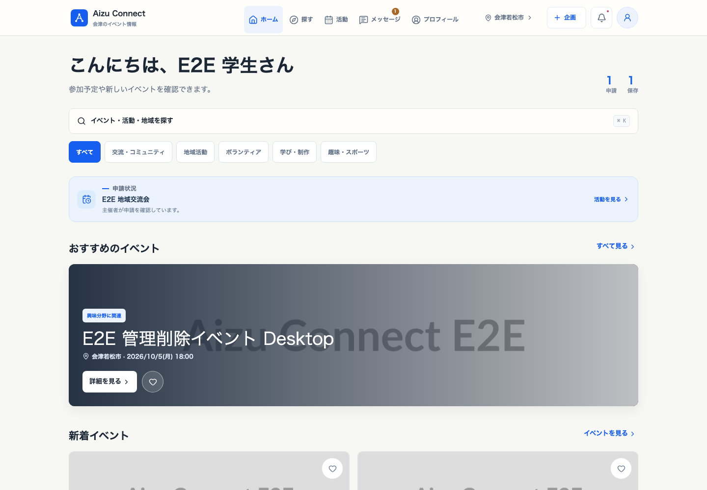
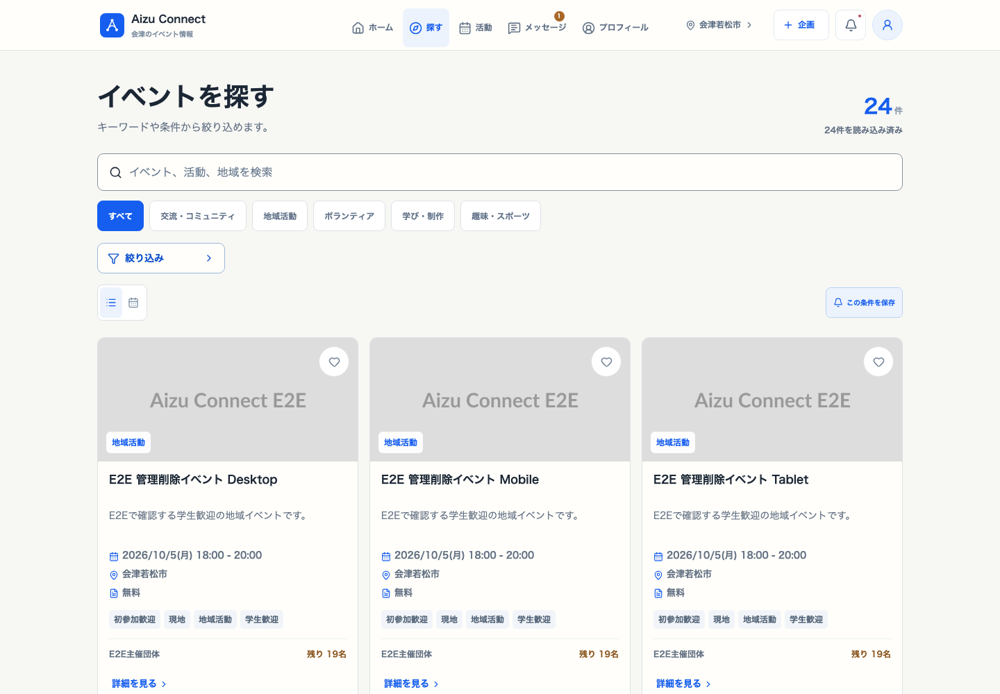
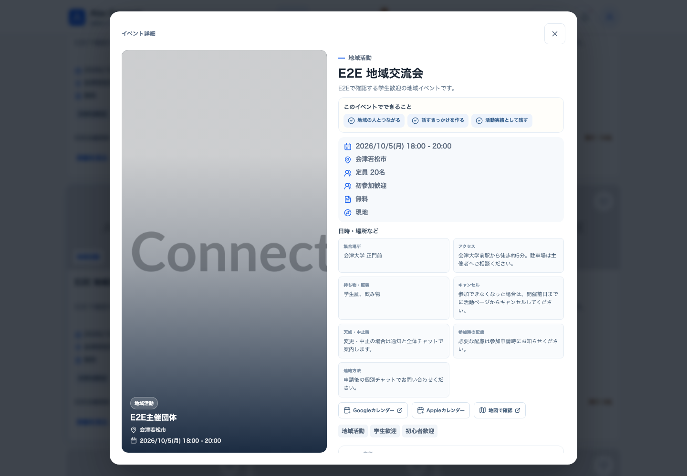
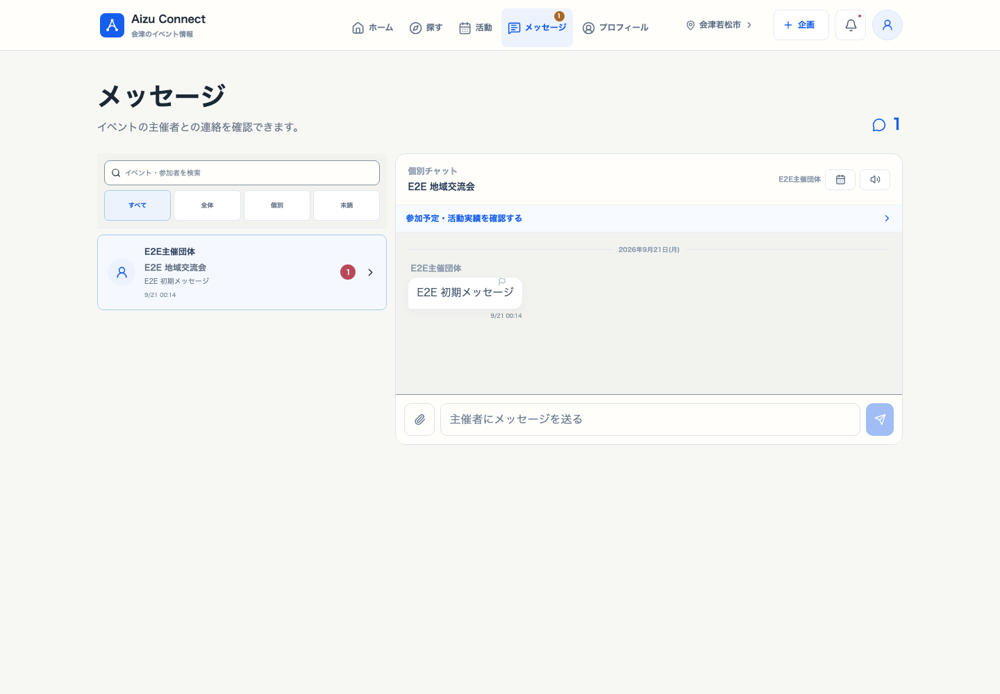
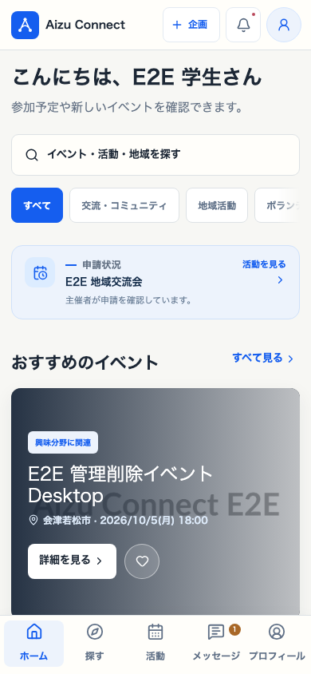
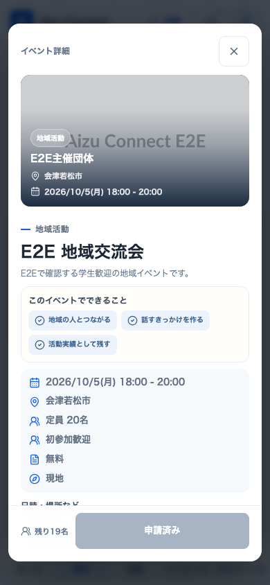
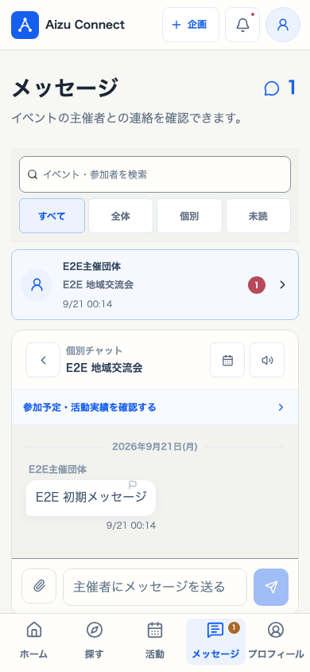

# Aizu Connect

[](https://github.com/okaka-1205/aizu-connect/actions/workflows/ci.yml)


学生が人と出会い、新しい経験や挑戦のきっかけを見つけるための、会津の活動プラットフォームです。

まだやりたいことが見つかっていない人や、何かに挑戦したい人が、所属や知り合いの有無に左右されず、気軽に地域・学生団体の活動へ参加できる場所を目指しています。

**公開サイト： [Aizu Connectを開く](https://aizu-connect-prod.web.app/)**

> 現在は少人数で利用するクローズドβ段階です。掲載イベントや協力団体を増やしながら、実際の利用で見つかった分かりにくさや不具合を改善しています。

## Aizu Connectでできること

### 学生・参加者

- 興味や開催日からイベントを検索し、新着順・人気順で比較
- イベントへの参加申請、申込質問への回答、キャンセル待ち
- 主催者との個別チャット、通知、イベントのお気に入り
- QRコードまたは受付コードによるチェックイン
- キャンセル、開催後アンケート、活動履歴の確認
- 活動実績・活動証明のPDF保存

### 主催者・団体

- イベントの下書き、プレビュー、複製、公開申請
- 定員・キャンセル待ち・申込質問・キャンセル期限の設定
- 参加者の検索、承認、連絡、出欠・QR受付管理
- 開催後アンケートの確認、写真付き活動報告の公開
- 過去イベントや参加状況を含む運営履歴の確認

### 管理者

- 主催者アカウントとイベント公開申請の審査
- 通報、問い合わせ、不適切ユーザーへの対応
- 担当者・対応期限・監査履歴を含む運用管理
- 法務関連記録の保管期限管理と定期削除

## このプロジェクトで私がしていること

Aizu Connectは、会津で新しい活動へ参加する際の「情報を見つけにくい」「初参加の連絡がしづらい」「主催者の申込管理が大変」といった課題を減らすために、個人で企画・開発・運営準備を進めているプロジェクトです。

具体的には、次の領域を一貫して担当しています。

- 学生と主催者が感じる課題の整理と、機能・画面設計
- 学生、主催者、管理者それぞれの利用フローの設計と実装
- Firebaseを利用した認証、データ管理、通知、定期処理、公開環境の構築
- 個人情報、通報、利用規約、プライバシー、安全な権限管理を含む運用設計
- 自動テスト、アクセシビリティ検査、負荷検証、Security Rules検証
- 本番環境の監視、問い合わせ対応、協力団体の開拓とクローズドβの準備

単にアプリを制作するだけでなく、学生と団体が実際のイベントで安心して使い続けられる状態を目標に、企画から実装、テスト、公開後の運用まで改善しています。

## 現在の品質状況

- Node.js 24、React、TypeScript、Firebaseで構成
- GitHub Actionsでlint、単体テスト、ビルド、Security Rules、ブラウザE2Eを自動実行
- Chromium、Firefox、WebKit、モバイル、タブレットをPlaywrightで検証
- axeによる重大・深刻なアクセシビリティ違反0件を維持
- 2026年10月19日のリリース確認で、明示的テスト277件・Playwright 190件が成功
- Firestore・Storage・AuthenticationでApp Checkを適用し、Security Rulesを自動検証
- 本番依存パッケージの既知の高重大度脆弱性0件を確認

詳細は[リリース準備最終確認](docs/release-readiness-2026-10-19.md)を参照してください。

## 技術構成

| 領域 | 使用技術 |
| --- | --- |
| フロントエンド | React 19 / TypeScript / Vite / Tailwind CSS |
| フォーム・データ取得 | React Hook Form / TanStack Query |
| バックエンド | Firebase Authentication / Firestore / Storage / Cloud Functions |
| 公開・定期処理 | Firebase Hosting / Cloud Scheduler |
| テスト | Vitest / Playwright / Firebase Emulator Suite / axe-core |
| CI | GitHub Actions |

## 参加者向け画面

以下はFirebase Emulatorの確認用データを使った参加者画面です。

### デスクトップ

| ホーム | イベントを探す |
| --- | --- |
|  |  |

| イベント詳細 | メッセージ |
| --- | --- |
|  |  |

[参加履歴](docs/screenshots/participant/04-desktop-activity.png) / [プロフィール](docs/screenshots/participant/06-desktop-profile.png)

### スマートフォン

| ホーム | イベント詳細 | メッセージ |
| --- | --- | --- |
|  |  |  |

## 開発環境

Node.js 24を使用します（`.nvmrc`対応環境では`nvm use`で切り替え）。

```bash
npm install
npm run dev
```

`npm run dev`は`npm run dev:local`を呼び出し、端末内のFirebase Emulatorだけを使用します。Functionsのビルド、Auth・Firestore・Storage・Functions Emulatorの起動、確認用データの投入、Viteの起動までをまとめて行います。

```bash
npm run dev:local
```

ローカル確認用URL：

- React: `http://127.0.0.1:5173/`
- Authentication: `127.0.0.1:19099`
- Firestore: `127.0.0.1:18082`
- Functions: `127.0.0.1:15001`
- Storage: `127.0.0.1:19197`

確認用アカウント：

| ロール       | メールアドレス             | パスワード    |
| ------------ | -------------------------- | ------------- |
| 学生         | `student-e2e@u-aizu.ac.jp` | `password123` |
| 主催者・団体 | `org-e2e@example.com`      | `password123` |
| 管理者       | `admin@aizu-connect.local` | `admin123`    |
| 審査用個人   | `pending-e2e@example.com`  | `password123` |

### E2Eテストの使い分け

認証テストと全体テストは、用途に応じてシードデータを分けています。

```bash
# 登録・ログイン・メール認証後の有効化だけを高速に確認
npm run test:e2e:auth:emulator

# チャット、通知、ページング、Functionsを含む全体確認
npm run test:e2e:full:emulator

# 上記に管理者承認、全ロール、アクセシビリティ検査を加えて実行
npm run test:e2e:emulator
```

軽量な認証テストではAuthとFirestoreだけを起動し、チャット履歴や通知トリガーを投入しません。PlaywrightはChromium、モバイル、タブレット、Firefox、WebKitを端末別データで検証します。

通常の総合検証と、負荷・定期処理・初期化まで含むリリース検証は次のように使い分けます。

```bash
# lint、ビルド、単体、Rules、全E2E
npm run verify

# verifyに加えて定期Functions、1,000人通知、初期化権限を確認
npm run release:check
```

本番スモークテストは、先に`npm run smoke:production:plan`で専用アカウントを確認し、[本番スモークテスト手順](docs/production-smoke-test.md)に従います。計画表示コマンド自体は本番へ接続しません。

公開後の日次・週次確認、障害対応、ロールバック、監視、バックアップ復元は[運用・障害対応手順](docs/operations-runbook.md)にまとめています。

## Firebase設定

本番用設定は、プロジェクトのルートにある`.env.production`で管理します。このファイルはGitへ追加しません。設定項目は`.env.example`を参照してください。

```env
VITE_FIREBASE_API_KEY=...
VITE_FIREBASE_AUTH_DOMAIN=...
VITE_FIREBASE_PROJECT_ID=...
VITE_FIREBASE_STORAGE_BUCKET=...
VITE_FIREBASE_MESSAGING_SENDER_ID=...
VITE_FIREBASE_APP_ID=...
VITE_FIREBASE_APP_CHECK_SITE_KEY=...
VITE_LEGAL_CONTACT_EMAIL=...
```

本番ビルドでは次を設定します。

```env
VITE_USE_FIREBASE_EMULATORS=false
```

ローカル開発から本番Firebaseへ直接接続する運用は禁止します。クラウド上の確認はデプロイ後の本番URLで行ってください。

## ロール

- `student`: イベント検索、参加申請、キャンセル待ち、チャット、受付、アンケート、活動実績
- `organization`: イベント作成・公開申請、参加者管理、チャット、受付、活動報告
- `admin`: アカウント・イベント審査、通報・問い合わせ対応、運用監査

本番の管理者アカウントは、初回ログイン時に認証アプリを使ったTOTP多要素認証の登録が必須です。端末紛失時の解除は、本人確認とプレビューを含む[運用・障害対応手順](docs/operations-runbook.md)に従います。

最初の管理者は、Firebase Admin SDKなど信頼できるサーバー側の手順で`users/{uid}`に`role: "admin"`、`status: "active"`を設定してください。クライアントから管理者へ変更できないRulesになっています。

### 管理者の初期設定

対象ユーザーを先に通常のメールアドレスで登録し、メール確認を完了した後、Firebase Admin SDKが利用できる環境で実行します。サービスアカウント鍵をリポジトリへ置かず、`GOOGLE_APPLICATION_CREDENTIALS`またはApplication Default Credentialsを使用してください。

```bash
gcloud auth application-default login
GCLOUD_PROJECT=aizu-connect-prod npm --prefix functions run admin:create -- admin@example.com
```

コマンドが成功したら、Authenticationの対象UIDとFirestoreの
`users/{uid}`が一致し、`role: "admin"`、`status: "active"`になっていることを
確認します。本番環境では、作業後に認証情報を端末から削除し、管理者アカウントへ
強い固有パスワードと多要素認証を設定してください。

### Emulatorでの管理者ログイン

開発中のFirebase Emulatorには、次のコマンドで運営アカウントを作成できます。

```bash
FIREBASE_AUTH_EMULATOR_HOST=127.0.0.1:9099 \
FIRESTORE_EMULATOR_HOST=127.0.0.1:8080 \
GCLOUD_PROJECT=demo-aizu-connect-local \
npm --prefix functions run admin:seed-emulator
```

開発画面のログインフォームでは、メールアドレスに`admin`、パスワードに`admin`と入力できます。これは開発環境だけのショートカットで、Firebase Authenticationの最低文字数制限を満たす実体アカウントへ内部変換します。本番ビルドでは有効になりません。

登録した学生をEmulator上でメール確認済みにして、参加申請のFunctions処理を確認する場合は次を使います。

```bash
FIREBASE_AUTH_EMULATOR_HOST=127.0.0.1:9099 \
GCLOUD_PROJECT=demo-aizu-connect-local \
npm --prefix functions run emulator:verify-user -- student@example.com
```

基本の運営確認フローは、主催者登録 → 管理者でアカウント承認 → 主催者でイベント申請 → 管理者でイベント公開 → 学生で参加申請 → 主催者で参加承認 → 学生の活動実績確認です。

## 確認コマンド

```bash
npm run lint
npm run build
npm run check
```

`Firebase: Error (auth/network-request-failed)` が表示された場合は、クラウド接続が制限されている可能性があります。起動中の通常開発サーバーを終了して`npm run dev:local`を使用してください。

Functionsを使う場合：

```bash
npm --prefix functions install
npm --prefix functions run build
```

## Hostingへの公開

Firebaseプロジェクト`aizu-connect-prod`を正式な本番環境として使用します。
旧`aizu-connect-dev`は移行確認とロールバックのためだけに保持します。
通常の開発と自動テストには`npm run dev:local`とEmulatorを使用し、本番データへ
テストデータを投入しないでください。

本番用設定は`.env.production`で管理し、`VITE_USE_FIREBASE_EMULATORS=false`を必須にします。`npm run build`は設定値と生成物を検査し、テストアカウント・Emulator接続先・仮画像サービスが混ざっている場合は失敗します。

利用規約とプライバシーポリシーには、公開可能な問い合わせ窓口として
`VITE_LEGAL_CONTACT_EMAIL`を設定します。未入力、仮メールアドレス、
プレースホルダーを含む場合、本番ビルドは失敗します。運営者の氏名・住所・
電話番号などはクライアント環境変数へ入れず、非公開の運用記録で管理し、
適法な請求があった場合に遅滞なく個別提供します。
登録時と重要改定後の再ログイン時には規約同意が必須で、同意日時、規約版、
年齢・法定代理人同意の確認をFirestoreの変更不可な同意記録へ保存します。
参加申請時の主催者への第三者提供記録は原則3年間保存し、期限後は
`purgeExpiredLegalRecords`が削除します。

管理者Callable FunctionsでApp Checkを強制する場合は、Firebase Consoleで
reCAPTCHA Enterpriseを登録し、`.env.production`へ
`VITE_FIREBASE_APP_CHECK_SITE_KEY`を設定します。Functions側には
`ENFORCE_ADMIN_APP_CHECK=true`を設定してください。クライアント設定前に
Functions側だけを有効化すると管理者操作が拒否されるため、同じリリースで
反映します。

```bash
npm run release:check

# 変更した対象だけを選んで公開する例
npx -y firebase-tools@latest deploy --project aizu-connect-prod --only hosting
```

Functions、Firestore Rules・Indexes、Storage Rulesを変更した場合は、影響範囲のテスト後に必要な対象だけを`--only`へ追加します。変更していないサービスをまとめて再デプロイしないでください。

デプロイ前に、Firebase ConsoleでAuthentication、Firestore、Storage、必要なBlazeプラン、承認済みドメインを確認してください。

## リリース前チェック

- 開発・E2EテストはEmulatorだけで行い、`aizu-connect-prod`へテストデータを投入しない
- 本番Authenticationの初期管理者が有効かつメール確認済みであることを確認する。MFAはクライアント対応後、各管理者本人が認証アプリで登録する
- `.env.production`と`functions/.env.*`をGitへ追加しない
- Firestore・Storage RulesをEmulatorテストと本番dry-runで検証する
- Authenticationのメール認証とパスワード再設定を確認する
- Storageを使う場合はStorage Rulesを追加する
- 公開可能な問い合わせ先を本番環境変数へ設定する。運営者情報は非公開の運用記録で管理し、適法な請求時に申込み前に遅滞なく提供する
- 主催者契約・審査手順に、参加者情報の目的外利用禁止と事故・漏えい時の連絡義務を定める
- 有料イベントごとに、主催者が販売主体、住所、電話番号、責任者、支払・返金条件を実在情報で登録したことを審査時に確認する
- Cloud Schedulerで`purgeExpiredLegalRecords`が有効であることを確認する
- Emulatorではなく本番Firebaseで学生・主催者・管理者の3導線をE2E確認する
- 個人情報の開示等請求、漏えい等報告、委託先管理の社内手順を整備する
