# Aizu Connect

[](https://github.com/okaka-1205/aizu-connect/actions/workflows/ci.yml)


**会津で見つける、新しい活動とつながり。**

学生と地域・学生団体をつなぐWebアプリです。イベントを探すところから、参加申請、主催者との連絡、当日の受付、活動の振り返りまでをひとつにまとめています。

「何かやってみたいけれど、きっかけがない」「知り合いがいないので参加しづらい」。そんな学生が、興味を持った活動に一歩踏み出せる場所を目指しています。

[**Aizu Connectを開く ↗**](https://aizu-connect-prod.web.app/) · [画面を見る](#画面) · [ローカルで動かす](#ローカルで動かす) · [開発ガイド](docs/development.md)

現在は少人数で利用するクローズドβです。掲載イベントや協力団体を増やしながら、実際の利用に合わせて改善しています。

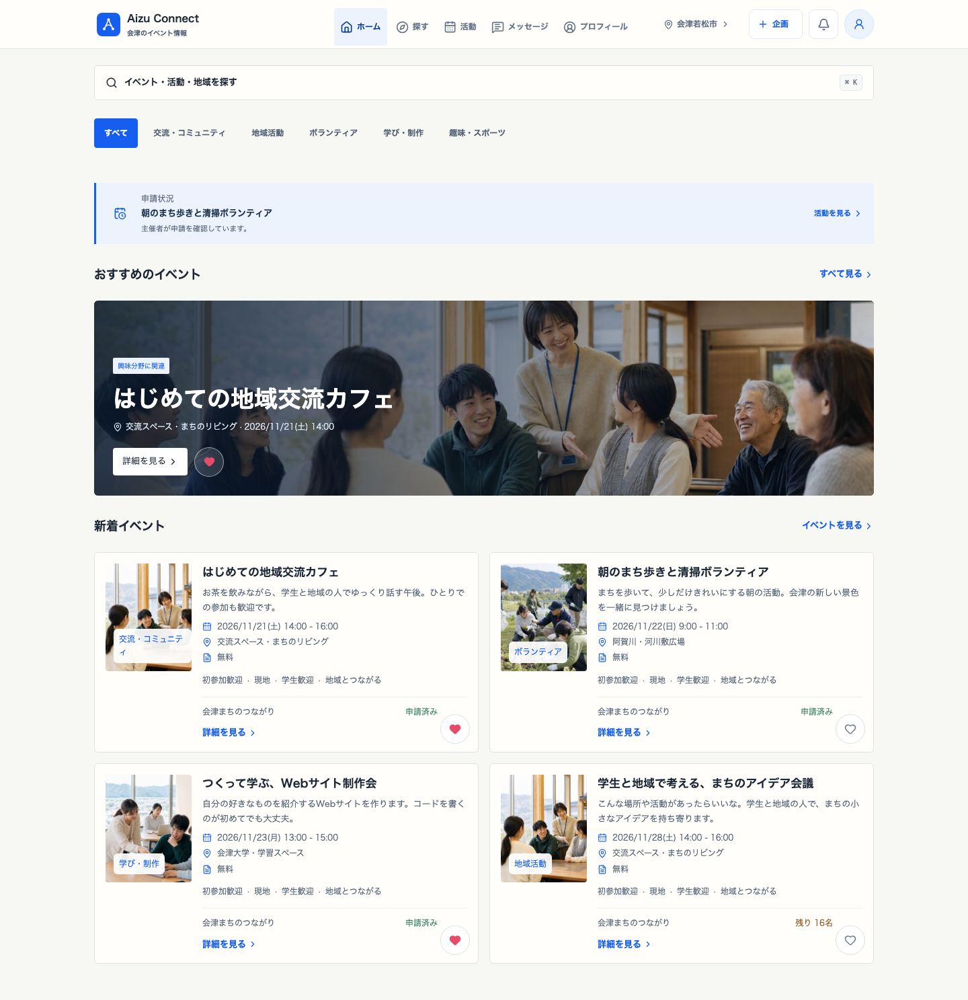

## できること

### 学生・参加者

| やりたいこと   | 主な機能                                                                       |
| -------------- | ------------------------------------------------------------------------------ |
| 活動を見つける | 興味・開催日・場所・参加費などで検索、カレンダー表示、イベントや検索条件の保存 |
| 参加する       | 参加申請、申込質問への回答、キャンセル待ち、申請状況の確認・キャンセル         |
| 連絡を取る     | イベントごとの全体チャット、主催者からの案内、通知                             |
| 当日参加する   | QRコード・6桁の受付コードによるチェックイン                                    |
| 経験を残す     | 参加履歴、開催後アンケート、年間の活動記録、活動証明書の表示・PDF保存          |

学生自身がイベントを企画・運営することもできます。

### 主催者・団体

| やりたいこと         | 主な機能                                                   |
| -------------------- | ---------------------------------------------------------- |
| 企画をつくる         | テンプレート、下書き、プレビュー、イベントの複製・公開申請 |
| 募集を管理する       | 定員、キャンセル待ち、申込質問、キャンセル期限の設定       |
| 参加者とやり取りする | 参加者検索・承認、全体チャット、出欠・QR受付の管理         |
| 開催後に振り返る     | アンケート集計、写真付き活動報告の公開、運営履歴の確認     |

アカウント・イベントの審査、通報対応などの管理者向け機能も備えています。

## 画面

2026年11月13日時点の開発版です。スクリーンショットの人物名・団体名・イベント・会話はすべて撮影用の架空データで、本番サイトの掲載内容とは異なります。

### スマートフォン

<table>
  <tr>
    <th>活動を探す</th>
    <th>内容を確認する</th>
    <th>参加者と連絡する</th>
  </tr>
  <tr>
    <td>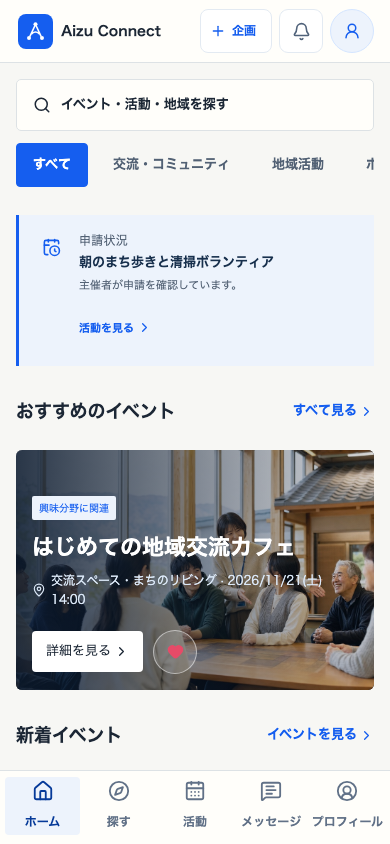</td>
    <td>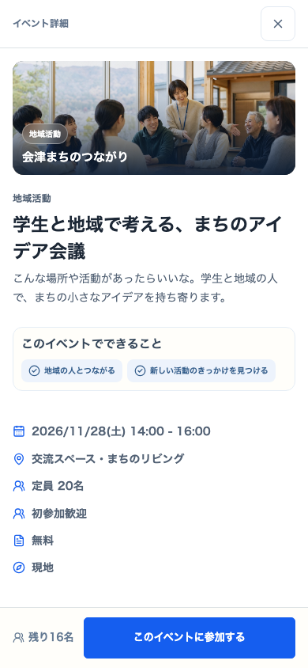</td>
    <td>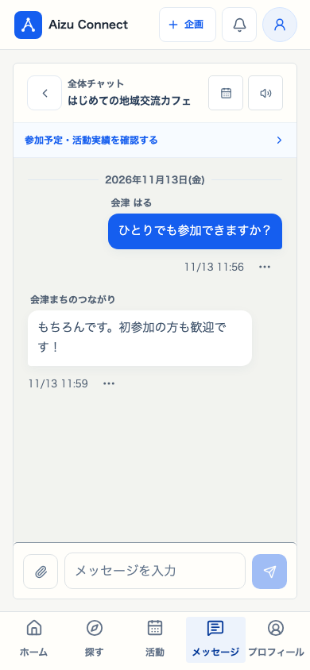</td>
  </tr>
</table>

片手で押しやすい操作領域、イベント詳細の固定ボタン、長い入力中も見えるチャット入力欄など、スマホでの使いやすさを整えています。

<details>
<summary><strong>PCの検索・参加履歴・プロフィールを見る</strong></summary>

| イベント検索                                                        | イベント詳細                                                              |
| ------------------------------------------------------------------- | ------------------------------------------------------------------------- |
| 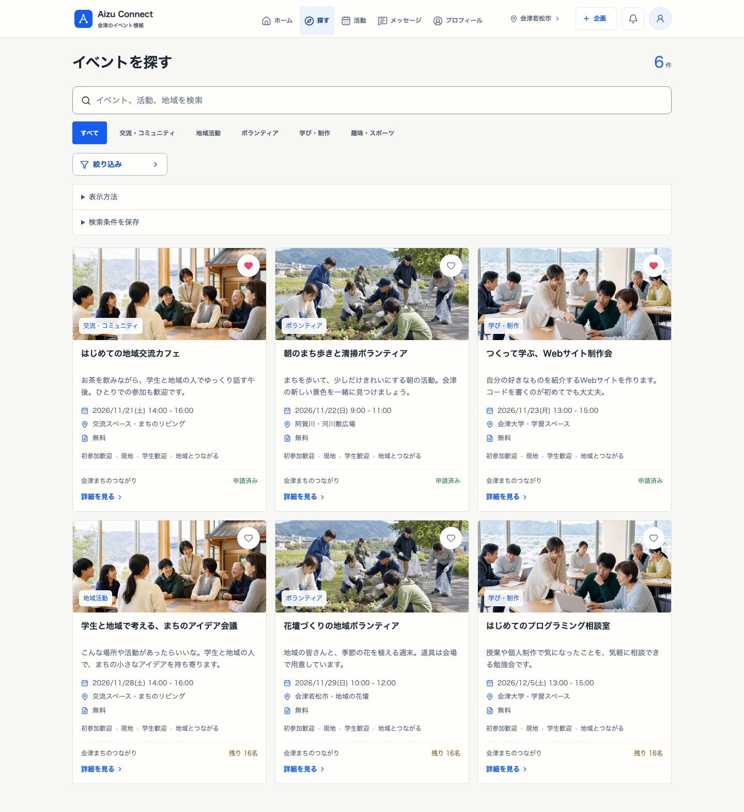 | 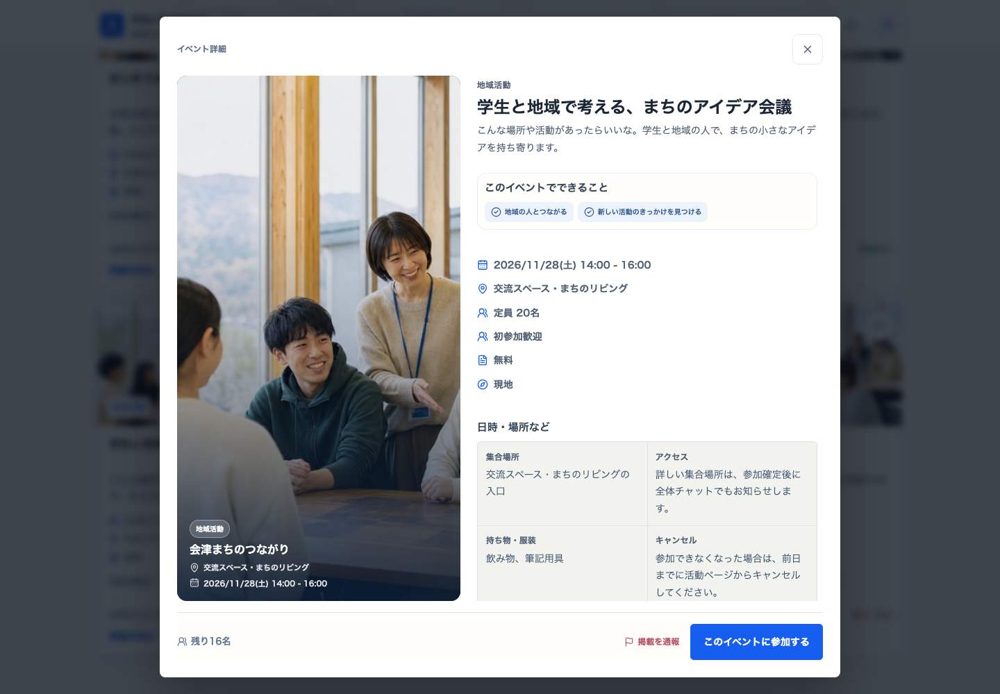 |

| 参加履歴・参加予定                                                | イベント全体チャット                                                    |
| ----------------------------------------------------------------- | ----------------------------------------------------------------------- |
| 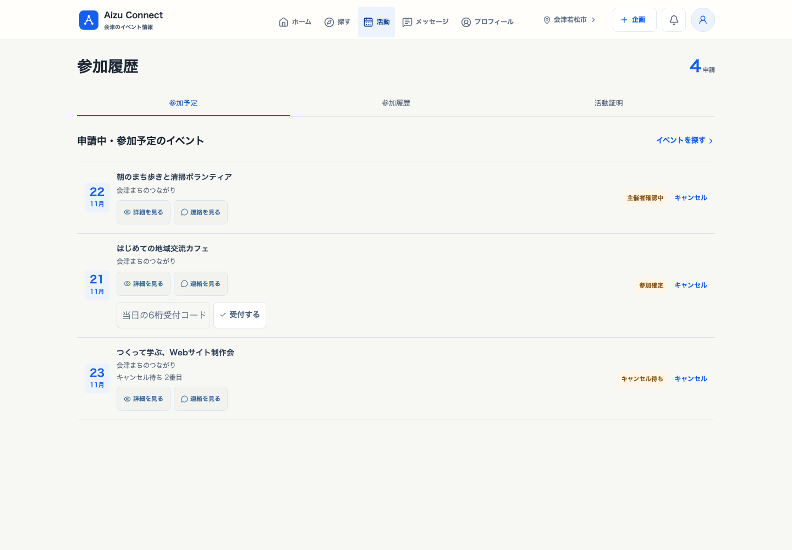 | 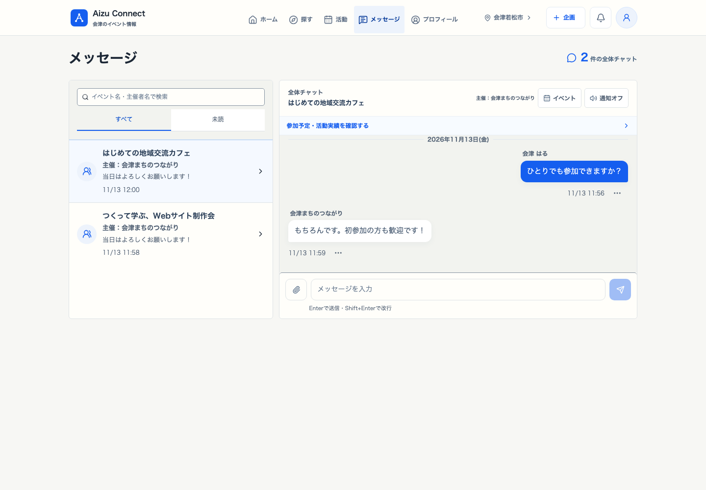 |

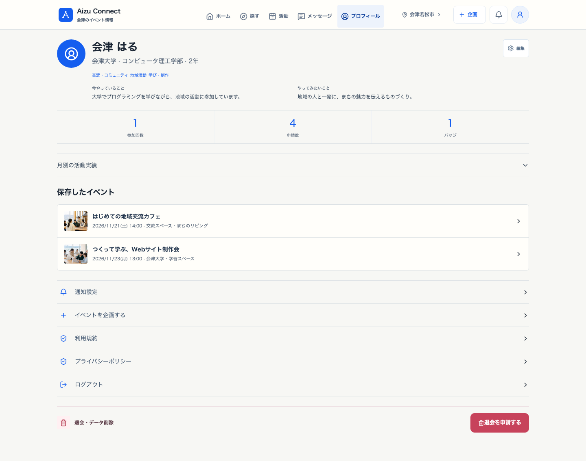

</details>

<details>
<summary><strong>主催者・団体の画面を見る</strong></summary>

| 団体ホーム                                                       | 参加者管理                                                               |
| ---------------------------------------------------------------- | ------------------------------------------------------------------------ |
| 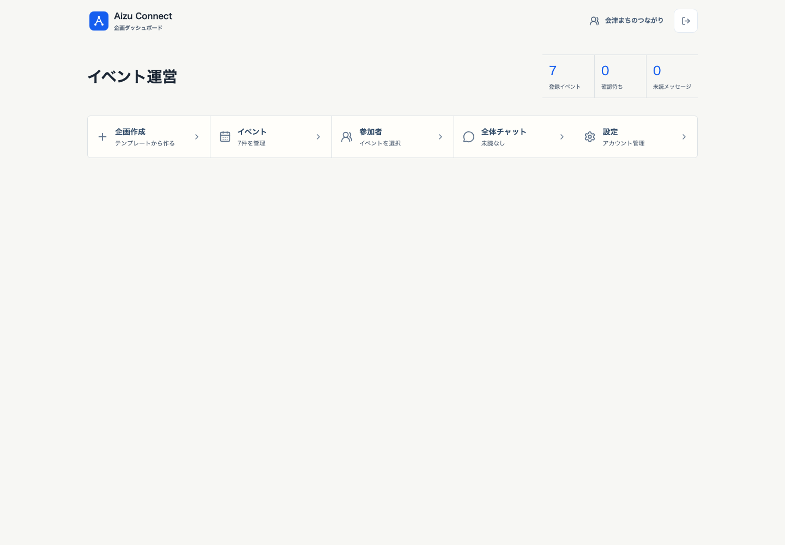 | 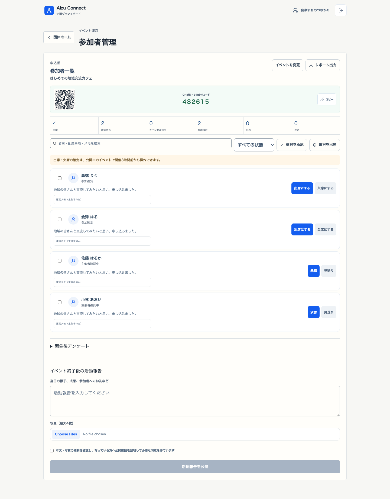 |

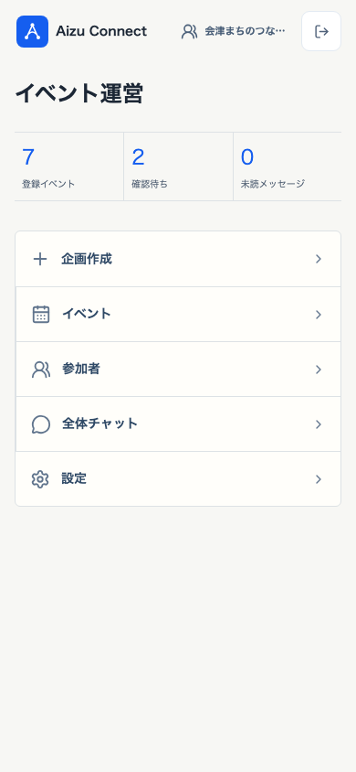

</details>

## 開発について

企画、画面・データ設計、実装、テスト、公開環境の構築、運用設計まで個人で進めています。

イベントの情報を集めるだけでなく、初参加の連絡のしやすさや主催者の申込管理まで、実際の利用の流れに沿って改善しています。最近は利用者・団体画面の余白や文字位置を揃え、カードや説明文を整理し、スマホでの視認性と操作性を見直しました。

### 技術構成

| 領域               | 技術                                                              |
| ------------------ | ----------------------------------------------------------------- |
| フロントエンド     | React 19 / TypeScript / Vite / CSS / Tailwind CSS                 |
| 認証・データ       | Firebase Authentication / Cloud Firestore / Cloud Storage         |
| サーバー処理・公開 | Cloud Functions for Firebase / Firebase Hosting / Cloud Scheduler |
| テスト             | Vitest / Playwright / Firebase Emulator Suite / axe-core          |
| CI                 | GitHub Actions                                                    |

### 検証

GitHub Actionsでlint、単体テスト、ビルド、Firestore・Storageの権限検証、ブラウザE2Eを実行しています。PlaywrightではChromium・Firefox・WebKitとスマホ・タブレット表示を検証し、axeによるアクセシビリティ検査も組み込んでいます。

直近のUI改善では、一覧のページ切り替え、未保存の入力保護、チャット操作などをChrome・モバイルChrome・WebKitで検証しています。確認範囲と変更内容は[利用者画面の改善記録](docs/student-ui-followup.md)にまとめています。

## ローカルで動かす

Node.js 24とJava 21を用意してください。JavaはFirebase Emulatorに使用します。

```bash
git clone https://github.com/okaka-1205/aizu-connect.git
cd aizu-connect
npm ci
npm ci --prefix functions
npm run dev
```

`npm run dev`でFunctionsのビルド、ローカルEmulatorの起動、確認用データの投入、Viteの起動まで実行します。ブラウザで `http://127.0.0.1:5173/` を開いてください。

| ローカル確認用アカウント | メールアドレス             | パスワード    |
| ------------------------ | -------------------------- | ------------- |
| 学生                     | `student-e2e@u-aizu.ac.jp` | `password123` |
| 主催者・団体             | `org-e2e@example.com`      | `password123` |

これらのアカウントはローカルEmulator専用です。開発・自動テストには本番データを使用しません。

### よく使うコマンド

| コマンド                     | 内容                                             |
| ---------------------------- | ------------------------------------------------ |
| `npm run lint`               | フロントエンドと補助スクリプトの静的検査         |
| `npm run test:unit`          | 単体テストと本番App Check設定の検査              |
| `npm run build:test`         | 型チェックとEmulator向けビルド                   |
| `npm run test:e2e`           | 認証UI・画面遷移・利用者の操作テスト             |
| `npm run test:e2e:emulator`  | Emulatorを使った機能・権限・アクセシビリティ検証 |
| `npm run screenshots:readme` | 専用デモ環境でREADMEの画像12枚を撮り直す         |

Emulatorのポート、テストの使い分け、本番用環境変数、管理者の初期設定、公開手順は[開発・検証・公開ガイド](docs/development.md)を参照してください。

## 関連ドキュメント

- [現行実装仕様書](docs/application-specification-2026-10-30.md) — 機能、画面遷移、データ、権限の詳細
- [スマホUIの改善記録](docs/mobile-ui-review.md) / [利用者画面の追加改善](docs/student-ui-followup.md)
- [責務分割・型安全性](docs/code-structure-and-type-safety-2026-10-30.md) / [容量・処理回数の改善](docs/optimization-results-2026-10-30.md)
- [運用・障害対応手順](docs/operations-runbook.md) — 監視、障害対応、ロールバック、バックアップ復元
- [本番スモークテスト手順](docs/production-smoke-test.md)
