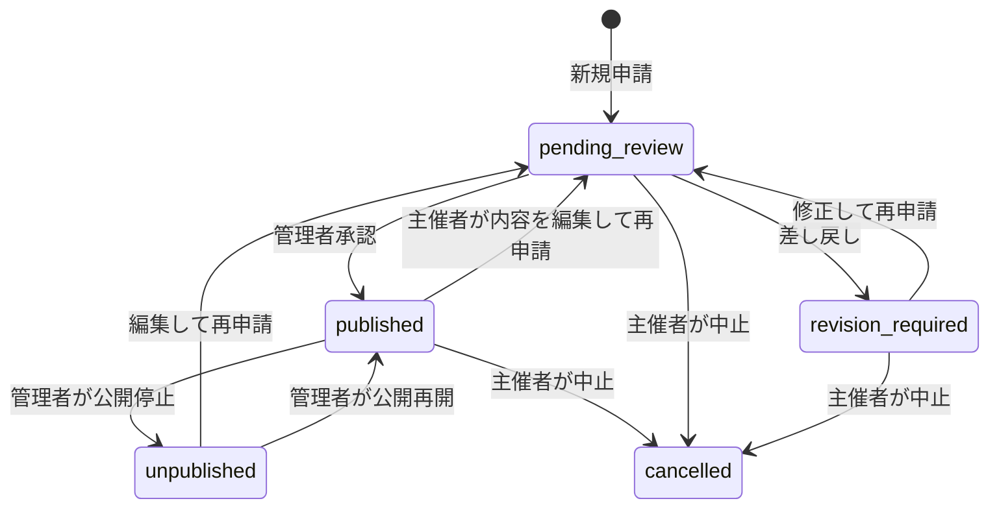
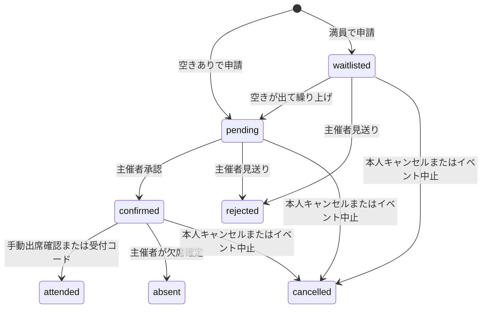
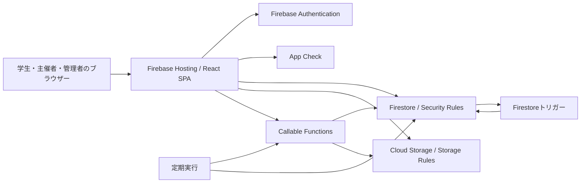

# Aizu Connect 現行実装仕様書

| 項目                     | 内容                                                                       |
| ------------------------ | -------------------------------------------------------------------------- |
| 作成日                   | 2026年10月30日（日本時間）                                                 |
| 文書の位置付け           | 現在の実装から作成した機能・基本設計仕様書                                 |
| 対象                     | 本リポジトリの作業ツリー。未コミットの改善・責務分割を含む                 |
| 基準コミット             | `3e1f1b0bb8242075fc04f178d32781bf8cb32a77`。このコミット単独の仕様ではない |
| package.jsonのバージョン | `1.0.0`                                                                    |
| サービス段階             | README上は少人数のクローズドβ                                              |
| 公開URL                  | [Aizu Connect](https://aizu-connect-prod.web.app/)（README記載）           |

本書の「現行」はローカルの実装を指す。作成時点では本番未反映の変更を含んでいたが、2026年10月30日21:45（日本時間）に改善一式を本番へ反映し、Hostingの配信物とFirestore Rulesの一致を確認した。反映対象・検証結果・本番確認の範囲は[デプロイ記録](./deployment-2026-10-30.md)を参照。企画上の将来案と、コードに実装されている機能は区別する。

## 目次

- [1. サービスの目的と範囲](#1-サービスの目的と範囲)
- [2. 利用者と権限](#2-利用者と権限)
- [3. 認証・アカウント](#3-認証アカウント)
- [4. 画面構成と遷移](#4-画面構成と遷移)
- [5. イベントの発見・保存](#5-イベントの発見保存)
- [6. イベント企画・審査](#6-イベント企画審査)
- [7. 参加申請・キャンセル待ち・出欠](#7-参加申請キャンセル待ち出欠)
- [8. 全体チャット・通知](#8-全体チャット通知)
- [9. 開催後・プロフィール](#9-開催後プロフィール)
- [10. 主催者・管理者の運用機能](#10-主催者管理者の運用機能)
- [11. データ構造](#11-データ構造)
- [12. サーバー処理・外部連携](#12-サーバー処理外部連携)
- [13. 安全性・個人情報](#13-安全性個人情報)
- [14. ページング・性能・アクセシビリティ](#14-ページング性能アクセシビリティ)
- [15. 技術構成とコードの配置](#15-技術構成とコードの配置)
- [16. 環境・運用・品質確認](#16-環境運用品質確認)
- [17. 現行の制約・確認事項](#17-現行の制約確認事項)
- [18. 参照資料](#18-参照資料)

## 1. サービスの目的と範囲

会津の学生が、地域・学生団体の活動を見つけ、参加し、その経験を活動実績として残すためのWebアプリケーション。

- 学生：イベントの発見、申請、連絡、受付、振り返り、活動実績の保存。
- 主催者：企画の作成、公開申請、参加者管理、連絡、出欠確認、開催後の確認。
- 管理者：アカウント・イベント審査、通報、利用停止・削除、対応記録の管理。
- 有効な学生アカウントでも、自分のイベントを企画・運営できる。

提供形態は日本語のブラウザー向けSPA。PC・スマートフォン・タブレットに対応する。ネイティブアプリ、決済代行、汎用の個別DMを現行の提供機能には含めない。

## 2. 利用者と権限

### 2.1 ロール

| ロール       | 内部値         | 主な操作                                                                                   |
| ------------ | -------------- | ------------------------------------------------------------------------------------------ |
| 学生・参加者 | `student`      | 公開イベント閲覧、参加申請、保存、全体チャット、受付、アンケート、活動実績、自分の企画運営 |
| 主催者・団体 | `organization` | 自分のイベント作成・編集・中止、参加者管理、全体チャット、アンケート結果、活動報告         |
| 管理者       | `admin`        | 審査、通報処理、ユーザー・公開イベント管理、削除、担当・期限管理、監査・利用状況確認       |

一般利用者の登録画面では、学生または団体を選択する。管理者を自己登録する導線はない。以下の保護された操作では、ロールだけでなく有効状態、メール認証、所有者・参加者との関係も確認する。

### 2.2 主なアクセス範囲

| データ・操作                               | 学生                           | 団体               | 管理者                                   |
| ------------------------------------------ | ------------------------------ | ------------------ | ---------------------------------------- |
| アカウント・学生プロフィール               | 原則自分                       | 原則自分           | 審査・管理対象                           |
| イベント                                   | 公開中、および自分の企画       | 自分の企画         | 審査・管理対象                           |
| 参加申請                                   | 自分の申請、自分の企画への申請 | 自分の企画への申請 | 管理対象                                 |
| 全体チャット本文・既読                     | メンバーである部屋             | メンバーである部屋 | 管理者ロールだけによる一律閲覧許可はない |
| 開催後アンケート                           | 自分の回答、自分の企画の結果   | 自分の企画の結果   | 閲覧可                                   |
| 受付コード                                 | 自分の企画のコード             | 自分の企画のコード | 閲覧可                                   |
| 保存イベント・保存検索・部屋ごとの通知設定 | 自分                           | 対応する自分の設定 | コレクションごとのRulesに従う            |
| 通報・監査履歴・担当登録                   | 通報の作成                     | 通報の作成         | 対応・閲覧・担当登録                     |

これは主な画面とクライアントRulesの要約。正確な許可条件は[Firestore Rules](../firestore.rules)と[Storage Rules](../storage.rules)を正とする。Admin SDKを使うFunctionsでは、各ハンドラー内で権限を別途確認する。

## 3. 認証・アカウント

### 3.1 登録・ログイン

| ID      | 機能             | 現行の挙動                                                                                  |
| ------- | ---------------- | ------------------------------------------------------------------------------------------- |
| AUTH-01 | 新規登録         | メールアドレス・パスワード、ロールに応じたプロフィールを登録                                |
| AUTH-02 | 学生情報         | 表示名、学科・所属、学年、興味、現在の活動、やってみたいこと                                |
| AUTH-03 | 団体情報         | 団体・自治体名を登録。団体名を表示名として使用                                              |
| AUTH-04 | パスワード       | 新規登録時は10文字以上。表示・非表示を切り替え可能                                          |
| AUTH-05 | 同意             | 利用規約・プライバシーポリシーと年齢条件等の確認が必要                                      |
| AUTH-06 | メール確認       | Firebase Authenticationの確認メールを送信。再送・確認状態の再取得に対応                     |
| AUTH-07 | パスワード再設定 | 入力したメールアドレスへ再設定メールを送信                                                  |
| AUTH-08 | セッション       | ローカル永続化を試し、失敗時はセッション永続化へ切り替える                                  |
| AUTH-09 | ログアウト       | 認証を終了し、検索条件・選択中画面・下書き等の画面状態をリセット                            |
| AUTH-10 | 登録失敗         | プロフィール保存前後の失敗を区別し、作成済みAuthユーザーの削除を試みる                      |
| AUTH-11 | プロフィール不在 | Authユーザーだけが存在する場合、登録処理の完了を最大約8秒待ち、その後ログアウト処理を試みる |

興味はカンマ区切り入力から最大5件へ変換する。プロフィール編集時の学年は0〜6、現在の活動・やってみたいことは各240文字まで。

### 3.2 初期状態と利用開始条件

| 登録区分                     | 作成時の状態       | 主な利用開始条件         |
| ---------------------------- | ------------------ | ------------------------ |
| `@u-aizu.ac.jp`の学生        | `active`           | 本番ではメール認証が必要 |
| その他のメールアドレスの学生 | `pending_approval` | メール認証と管理者承認   |
| 団体                         | `pending_approval` | メール認証と管理者承認   |

既存の会津大学学生が`pending_approval`で残っている場合は、メール確認後に`active`へ移行する互換処理がある。

アカウント状態には`active`、`pending_approval`、互換用の`pending`、`email_unverified`、`profile_incomplete`、`rejected`、`suspended`がある。本番の画面ゲートはメール未確認を先に確認し、拒否・停止、承認待ち、登録内容確認へ振り分ける。

### 3.3 管理者と利用条件の再同意

- 本番の管理者はTOTP方式の多要素認証を利用する。未登録時は登録画面へ移動する。
- 管理操作では有効な管理者アカウント、確認済みメール、認証トークン上のTOTP認証を確認する。
- 学生・団体は、保存された規約・プライバシーの版や年齢条件確認が不足していると、再同意画面へ移動する。
- 現行の規約・プライバシーポリシーの版は、いずれも`2026-10-23`。
- 同意はユーザー情報と`legalConsents`へ記録する。

参照：[認証フォーム](../src/hooks/useAuthForm.ts)、[アクセスゲート](../src/lib/appLogic.ts)、[認証画面](../src/screens/auth/AuthScreens.tsx)、[管理者認証](../functions/src/lib/adminAuthorization.ts)。

## 4. 画面構成と遷移

### 4.1 学生画面

| タブ           | 内部値     | 主な内容                                             |
| -------------- | ---------- | ---------------------------------------------------- |
| ホーム         | `home`     | 推薦、公開イベント、活動状況への導線                 |
| イベントを探す | `search`   | 検索・絞り込み・並べ替え・保存検索・一覧／カレンダー |
| 活動           | `activity` | 参加予定、履歴、受付、アンケート、活動実績・証明     |
| メッセージ     | `messages` | イベント全体チャットの一覧・履歴・投稿               |
| プロフィール   | `profile`  | プロフィール編集、保存イベント、通知設定、退会申請   |

イベント詳細、参加申請、通知、通報、活動証明などはダイアログやパネルとして表示する。

### 4.2 主催者・管理者画面

- 主催者：ホーム、企画作成、イベント管理、参加者管理、全体チャット、設定。
- 学生の企画運営でも主催者ダッシュボードを共用し、学生画面へ戻る導線を持つ。
- 管理者：審査・運用指標、イベント審査、アカウント審査、通報、退会申請、ユーザー管理、公開イベント管理、監査履歴。

### 4.3 URLと共通操作

| パラメーター                  | 用途                             |
| ----------------------------- | -------------------------------- |
| `tab`                         | 学生タブ                         |
| `event`                       | 選択イベント                     |
| `orgView`                     | 主催者の表示区分                 |
| `checkInEvent`、`checkInCode` | QRリンクから受付コードを受け渡す |

ブラウザーの戻る・進むへ対応する。学生画面には検索へ移動する`Ctrl+K`／`⌘+K`、メインコンテンツへのスキップリンク、タブ移動時のフォーカス制御がある。QRリンクは活動画面で該当の参加確定済み申込を見つけた際にコードを入力欄へ反映し、URLからコードを除去する。

## 5. イベントの発見・保存

### 5.1 検索条件

| 項目       | 条件                                                                             |
| ---------- | -------------------------------------------------------------------------------- |
| キーワード | タイトル、概要、場所、主催者名、初心者歓迎度、体験内容、タグを対象とする部分一致 |
| カテゴリー | すべて、交流・コミュニティ、地域活動、ボランティア、学び・制作、趣味・スポーツ   |
| 日付       | すべて、今週、今月。「今週」は現在から7日先まで                                  |
| 曜日       | すべて、平日、土日                                                               |
| 時間帯     | すべて、午前、午後、夜。午前は12時未満、午後は12時以上18時未満、夜は18時以降     |
| 参加費     | すべて、無料、有料                                                               |
| 開催形式   | すべて、現地、オンライン、ハイブリッド                                           |
| その他     | 空きがあるイベントのみ、初心者歓迎のみ                                           |
| 並び順     | 開催が近い順、人気順、新着順                                                     |
| 表示       | リスト、日付ごとのカレンダー表示                                                 |

人気順のサーバー取得は`applicantCount`降順、新着順は`createdAt`降順、開催順は`startAt`昇順。開始日時を過ぎたイベントは検索候補から除外する。人気順・新着順でも、開始済みの取得データを読み飛ばしてページを構成する。

公開イベントは24件単位のカーソル取得。細かな絞り込みは読み込み済み候補に対して行う。検索条件がある場合、最大3ページ分を追加で自動取得する処理があり、それ以降は利用者が追加取得する。検索結果の表示件数はDB全体の一致総数ではない。

### 5.2 推薦・保存・主催者情報

- 推薦は読み込み済みの開催予定イベントから1件選ぶ。興味の一致数×100から開催までの日数を引いた値で比較し、同点では先に見つかった候補を維持する。
- イベントのお気に入り保存・解除に対応する。保存変更は画面へ先行反映し、通信失敗時は戻す。
- 保存した検索条件を再適用・削除できる。同じ条件は既存IDを再利用する。並び順とリスト／カレンダーの選択は保存条件の対象外。
- 詳細画面では主催者の公開プロフィール、公開イベント数、主催者の保存・解除、公開済み活動報告を表示する。
- 詳細画面からGoogleカレンダー登録画面を開く、またはICSファイルを保存する。
- オンライン以外の企画では、集合場所または開催場所をGoogleマップで検索するリンクを表示する。主催者の過去の公開イベントは最大5件を表示する。

参照：[検索](../src/hooks/useEventSearch.ts)、[イベント取得](../src/repositories/eventsRepository.ts)、[詳細画面](../src/screens/shared/EventDrawer.tsx)。

## 6. イベント企画・審査

### 6.1 作成・編集

有効な学生または団体が企画できる。入力は「基本情報」「開催情報」「詳細・確認」の3段階で、前に進む際に入力制約を確認する。

| 項目群         | 主な内容・制約                                                               |
| -------------- | ---------------------------------------------------------------------------- |
| 基本           | タイトル1〜80文字、概要1〜220文字、カテゴリー、テンプレート                  |
| 体験内容       | 1〜3件、各1〜60文字。初心者歓迎度は3区分                                     |
| 日程・場所     | 開催・終了日時、場所1〜80文字、集合場所1〜160文字、開催形式                  |
| 定員           | 整数1〜1,000人                                                               |
| 費用           | 無料／有料。金額0〜1,000,000円、有料は1円以上                                |
| 申込質問       | 最大8問。1行、複数行、選択式、確認チェック。必須・要配慮情報を指定可能       |
| 質問制約       | 質問文1〜120文字。選択肢は選択式で2〜8件、各1〜80文字                        |
| 運営情報       | 持ち物、キャンセル方針、雨天対応、配慮事項、問い合わせ方法、主催者紹介・経験 |
| キャンセル期限 | 任意。指定時は現在より後、開催日時より前                                     |
| 写真           | JPEG・PNG・WebP。元画像20MiB未満、切り抜き・圧縮後の保存画像は5MiB未満       |
| 有料の追加情報 | 販売主体名、住所、電話、責任者、支払方法・時期、追加費用、キャンセル方針     |

開催日時は申請時点より未来、終了日時は開催日時より後が必要。終了未入力時は画面側で開始の2時間後を補完する。サーバーでも形式・範囲・所有者を検証する。

交流会、勉強会、ボランティアのテンプレートを用意する。例文・画像を参照できるが、保存対象は入力した内容。プレビュー、元写真からの再調整、企画の複製に対応する。

### 6.2 下書き

- 新規企画のテキスト等を、UID別のブラウザー`localStorage`へ約400msの待機後に保存する。
- 再表示時に復元し、保存時刻を表示する。意味のある入力がない下書きは除去する。
- 既存企画を編集中は、新規企画のローカル下書きを上書きしない。
- 画像ファイル自体はローカル下書きへ永続保存しない。端末間の下書き同期機能はない。
- 申請成功時に下書きを削除する。複製時は開催日時を空にし、元イベント写真ではなくテンプレート画像へ戻す。

### 6.3 イベント状態

| 状態                | 意味                                       |
| ------------------- | ------------------------------------------ |
| `pending_review`    | 公開審査待ち。申請・再申請時の状態         |
| `revision_required` | 修正依頼。理由を確認して再申請する         |
| `published`         | 公開中。参加者が検索・申請できる           |
| `unpublished`       | 管理者による公開停止。中止とは扱いが異なる |
| `cancelled`         | 中止                                       |

公開済みの内容を編集すると再審査待ちとなる。承認済みの旧内容を公開し続ける別バージョン管理はない。中止では進行中の参加申請をキャンセルし、通知を作成し、全体チャットを読み取り専用にする処理が非同期で動く。公開停止では申請を自動キャンセルしない。

参照：[編集フック](../src/screens/organization/hooks/useOrganizationEventEditor.ts)、[サーバー入力検証](../functions/src/applicationLogic.ts)、[管理操作](../functions/src/callables/adminManageResource.ts)。

## 7. 参加申請・キャンセル待ち・出欠

### 7.1 申請

1. イベント詳細から申請画面を開く。
2. 内容・キャンセル条件・有料の場合の費用等を確認する。
3. 任意メッセージ、必要な配慮、緊急連絡先、主催者の質問へ回答する。
4. 同意内容を確認して送信する。
5. サーバーがアカウント、公開状態、開催前であること、重複、回答、定員を確認する。

参加者メッセージと配慮事項は各500文字、緊急連絡先は200文字まで。追加質問の回答は文字列または真偽値で、文字列は最大1,000文字。配慮事項・要配慮質問へ回答した場合は専用の同意、第三者の緊急連絡先を入力した場合は提供権限の確認が必要。

イベントと学生の組み合わせから`${eventId}_${userId}`を作り、同じIDが既に存在する場合は重複申請として拒否する。申請作成と定員の更新はトランザクションで処理する。

### 7.2 申請状態

| 内部状態     | 表示           |
| ------------ | -------------- |
| `pending`    | 主催者確認中   |
| `waitlisted` | キャンセル待ち |
| `confirmed`  | 参加確定       |
| `rejected`   | 見送り         |
| `attended`   | 出席確認済み   |
| `absent`     | 欠席扱い       |
| `cancelled`  | キャンセル済み |

### 7.3 キャンセル待ちと主催者の管理

- `pending`と`confirmed`が定員枠を使用する。満員の新規申請は`waitlisted`となる。
- 待機順は増加する連番で管理する。空きが出ると先頭の待機者を`pending`へ繰り上げ、主催者が承認する。
- 表示される待機番号は保存された番号で、辞退のたびに残りの全員を振り直す処理ではない。
- 主催者は申請者名の検索、状態の絞り込み、個別承認・見送り、確認済み参加者の出席・欠席、選択者の一括承認・出席確定を行う。
- 運営メモは500文字まで。
- 本人キャンセルは`pending`／`waitlisted`／`confirmed`が対象。期限が設定されている場合はその期限内に限る。理由を記録する。
- 自動繰り上げ・通知・活動実績作成はFirestoreトリガーによる非同期処理で、申請更新と完全に同時の表示反映ではない。

### 7.4 受付

| 項目           | 仕様                                                                                  |
| -------------- | ------------------------------------------------------------------------------------- |
| コード         | イベント作成トリガーで生成する6桁の数字                                               |
| 主催者画面     | QR画像、コード表示・コピー                                                            |
| 参加者画面     | 6桁を入力、またはQRリンクから入力欄へ反映して受付                                     |
| 対象           | 有効・メール確認済み学生の、本人の`confirmed`申込                                     |
| コード受付時間 | 公開中イベントの開始3時間前〜終了24時間後。終了日時欠損時は開始12時間後を終了とみなす |
| 手動の出欠確定 | 開始3時間前以降。クライアントRules上、コード受付と同じ終了上限は設けていない          |
| 誤入力制限     | イベント×学生単位。5回失敗で15分ロック                                                |
| 成功           | 申込を`attended`へ更新し、失敗回数の記録を削除                                        |

ブラウザー内蔵のカメラ読み取り画面はない。QRは端末側のカメラ等でURLを開くためのもの。

参照：[参加申請画面](../src/screens/student/ApplicationDialog.tsx)、[Functions](../functions/src/index.ts)、[状態更新トリガー](../functions/src/triggers/notifications.ts)。

## 8. 全体チャット・通知

### 8.1 全体チャット

- イベントごとに`event_${eventId}`という部屋を作る。主催者と申請した学生が参加する。
- 入室は申請時点で行うため、承認前・キャンセル待ちの学生もメンバーになり得る。
- 新規メンバーは参加前の履歴も読める。画面・システムメッセージでも全体チャットであることを案内する。
- 一覧検索、未読のみ表示、部屋ごとの通知ミュート、既読表示、過去メッセージの追加取得に対応する。
- テキストは1〜2,000文字。添付はJPEG・PNG・WebP・PDF・プレーンテキスト・CSV、10MiB未満。
- 自分の投稿はサーバー経由で編集・削除できる。編集履歴は直近20件を保持する。
- 削除は削除済み文言へ変更し、本文の編集履歴と添付URL等をドキュメントから除去する。Storage実体の即時削除までをこの操作で保証する仕様ではない。
- 主催者は固定メッセージ180文字、主催者からのお知らせ220文字を設定できる。
- 送信失敗時は下書きを戻し、送信中に書いた別の下書きを上書きしないよう扱う。

添付URLはStorageのダウンロードURLを保存する構成。部屋のRulesだけで、転送されたダウンロードURLの利用まで制御するとは扱わない。

### 8.2 通知

| 種類       | 主な契機                                                 |
| ---------- | -------------------------------------------------------- |
| 公開・新着 | 管理者のイベント公開。学生には保存検索条件も照合         |
| 申請       | 新規申請、承認、見送り、繰り上げ、出席、欠席、キャンセル |
| チャット   | 自分以外の投稿。全体設定・部屋ミュート等を考慮           |
| 開催前     | 確定参加者へ、開催前24時間以内／2時間以内の区分          |
| 運営       | 中止、公開停止、アカウント停止、削除など                 |

通知はFirestore上のアプリ内通知。一括既読は、表示中だけでなく本人の未読通知をサーバーで400件ずつ処理する。ブラウザープッシュ・SMS・イベント通知メールの配信機能は確認できない。認証・再設定メールは別系統。

新着、申請更新、チャット、開催リマインダーの通知設定を持つ。新着通知の保存検索条件は現行サーバー実装でユーザーごとに最大10件を参照する。リマインダーは毎時実行のため、厳密に開始24時間前・2時間前へ配送する仕様ではない。

参照：[チャットRepository](../src/repositories/chatRepository.ts)、[メッセージ操作](../functions/src/index.ts)、[通知トリガー](../functions/src/triggers/notifications.ts)、[定期処理](../functions/src/scheduled/maintenance.ts)。

## 9. 開催後・プロフィール

### 9.1 アンケート

- `attended`の本人が回答可能。満足度1〜5の整数、おすすめの真偽値、感想1,000文字まで。
- 保存先は`eventSurveys/{eventId}/responses/{userId}`で、同じ学生の再保存は同じ回答を更新する。
- 画面内では送信済み判定と送信中の重複防止を行う。失敗時は入力を保持して再試行可能。
- 再読み込み後に既存回答を入力フォームへ復元する処理はない。
- 主催者の「開催後アンケート」は、開いた際に全回答件数・平均満足度・おすすめ率と、回答一覧を取得する。
- 回答一覧は50件ずつ、作成日時の降順。集計は一覧の取得済みページに限らず全回答を対象とする。
- 学生企画も作成者は結果を閲覧可能。無関係な主催者・学生は一覧を閲覧できない。
- 結果画面に回答者名・UIDは表示しないが、保存データはUIDと対応する。匿名回答を保証する仕様ではない。

### 9.2 活動実績・証明

- 出席確認のトリガーが`activities`を作成し、証明番号`AC-${applicationId}`を設定する。
- 活動の年月はイベント開催日時を基準に東京時刻で作成する。
- 活動画面で証明済み活動、主催者数、体験内容、月別実績等を表示する。
- 活動証明ダイアログを表示し、端末の共有機能またはテキストコピー、ブラウザー印刷によるPDF保存へ対応する。
- 読み込み済みの証明済み活動を、活動実績PDFとしてダウンロードする。
- 本サービス内の出席確認を表すもので、学校等の外部機関の認定や外部公開の検証サービスは実装範囲外。

### 9.3 活動報告

- 主催者は本文2,000文字まで、写真最大4枚、本文・写真の権利確認を付けて公開する。
- 公開済み報告はイベント詳細から表示する。
- 現行Rulesの作成・更新は`organization`のイベント所有者に限定する。学生企画の活動報告公開は、共通画面が表示されても同じ権限では許可されない。
- 報告に保存する参加人数は、その時点で画面に取得済みの申請のうち`attended`の件数。

### 9.4 プロフィール・退会

- 表示名、学科・所属、学年、興味、現在の活動、やってみたいこと、プロフィール写真を編集する。
- 写真は切り抜き・圧縮・元画像からの再調整、送信進捗を備える。
- 保存した公開イベント、通知設定、アカウント削除申請を表示する。
- 学生・団体は退会理由を付けて削除を申請し、処理前は申請を取り消せる。利用者自身による即時のAuthアカウント削除ではない。

参照：[活動画面](../src/screens/student/ActivityTab.tsx)、[アンケート結果](../src/screens/organization/components/EventSurveyResults.tsx)、[プロフィール](../src/screens/student/ProfileTab.tsx)。

## 10. 主催者・管理者の運用機能

### 10.1 参加者一覧・CSV

主催者はイベント別の参加申請を取得し、氏名の前方一致検索と状態の絞り込みを行う。通常は作成日時降順。氏名検索時は小文字化した氏名を使う。

CSVには、イベント名、開催日時、定員、申請数、参加者名、状態、申請日時、参加者メッセージ、配慮事項、緊急連絡先、運営メモを出力する。UTF-8 BOM付きで、対象はその時点の取得済み申請。全申請を別途自動取得して出力する方式ではない。

### 10.2 管理者の操作

| ID     | 操作                   | 主な結果                                                                                     |
| ------ | ---------------------- | -------------------------------------------------------------------------------------------- |
| ADM-01 | アカウント承認・見送り | ユーザーと関連プロフィール／団体情報の状態を同期                                             |
| ADM-02 | イベント承認・差し戻し | 公開または修正依頼。理由・審査者・日時等を記録                                               |
| ADM-03 | 通報処理               | 対応済み`resolved`、または却下`dismissed`。対応理由を記録                                    |
| ADM-04 | ユーザー停止・復旧     | `suspended`／`active`へ変更。管理者自身等の制約はサーバーで確認                              |
| ADM-05 | イベント公開停止・再開 | `unpublished`／`published`へ変更                                                             |
| ADM-06 | イベント削除           | 申請、部屋、保存、受付、報告、アンケート、画像等を関連処理付きで削除                         |
| ADM-07 | ユーザー削除           | 所有イベント・申請等を削除し、共有チャットの投稿を匿名化、関連ファイル・Authユーザー等を削除 |
| ADM-08 | 担当・期限             | 自分を担当登録し、未対応／対応中／完了、任意の期限を保存                                     |
| ADM-09 | 監査                   | 操作主体、対象、理由、日時を確認                                                             |
| ADM-10 | 利用状況               | DB集計による利用状況と描画エラー集計を表示・再取得                                           |

通報理由は、不適切な内容、迷惑行為・スパム、個人情報、詐欺・危険な勧誘、その他。画面の通報対象はイベントまたはメッセージ、説明は最大1,000文字。

担当登録の内部状態は`open`／`in_progress`／`completed`。旧値`done`は読み込み時に`completed`へ変換する。期限を空にして保存すると、保存済み期限フィールドを削除する。読み込み・保存の失敗表示と再試行を備える。

管理操作にはリクエストIDを付与し、`adminOperations`で重複・実行中・完了を管理する。同じ操作の再試行ではIDを再利用する。関連削除は複数処理にまたがり、全データを一つのトランザクションで同時削除する仕様ではない。

### 10.3 指標の定義

全ユーザー、有効ユーザー、団体ユーザー、直近30日登録数、公開イベント数、全申込数、直近30日申込数、申込成立率、キャンセル率、直近7日の日次描画エラー集計を表示する。

- 申込成立率：現在`confirmed`または`attended`の申込数÷全申込数。
- キャンセル率：現在`cancelled`の申込数÷全申込数。
- 上記2率は直近30日限定ではない。ページ閲覧から申込への転換率でもない。
- 日次エラー集計の日付キーはUTC。イベント・活動年月の東京時刻とは区別する。
- 審査件数や最古日数など一部の画面指標は取得済みデータから計算し、未取得分がある場合は`50+`等の表示で区別する。

参照：[管理画面](../src/screens/admin/AdminDashboard.tsx)、[管理データ](../src/screens/admin/hooks/useAdminDashboardData.ts)、[管理操作](../functions/src/callables/adminManageResource.ts)、[利用状況集計](../functions/src/callables/adminDashboardMetrics.ts)。

## 11. データ構造

主DBはCloud Firestore。アカウント認証はFirebase Authentication、ファイルはCloud Storageで管理する。日時の主要な保存型はFirestore Timestamp。

### 11.1 業務データ

| コレクション／パス                 | 主なキー             | 用途・主要項目                                         |
| ---------------------------------- | -------------------- | ------------------------------------------------------ |
| `users`                            | UID                  | ロール、状態、メール、表示名、プロフィール、規約同意版 |
| `studentProfiles`                  | UID                  | 学生情報、認証・活動関連プロフィール                   |
| `organizations`                    | UID                  | 団体名、連絡先、紹介、状態、作成者                     |
| `publicOrganizerProfiles`          | UID                  | 公開用主催者名、紹介、経験、公開件数、確認状態         |
| `events`                           | イベントID           | 企画内容、日時、定員、件数、費用、所有者、審査状態     |
| `eventApplications`                | イベントID＋UID      | 申込状態、回答・同意、配慮・緊急連絡先、運営メモ       |
| `chatRooms`                        | `event_`＋イベントID | 部屋、主催者、人数、状態、最新投稿、お知らせ           |
| `chatRooms/{id}/members`           | UID                  | メンバー本人のID・表示名・参加時刻                     |
| `chatRooms/{id}/messages`          | 投稿ID               | 本文、送信者、添付、編集履歴、削除状態                 |
| `chatRooms/{id}/reads`             | UID                  | メンバーの最終既読時刻                                 |
| `notifications`                    | 通知ID               | 受信者、種別、件名・本文、対象、既読                   |
| `notificationPreferences`          | UID                  | 通知種別ごとの有効・無効                               |
| `chatPreferences`                  | 部屋ID＋UID          | 部屋ごとのミュート                                     |
| `savedEvents`                      | UID＋イベントID      | イベント保存                                           |
| `savedSearches`                    | 保存検索ID           | 検索条件、名前、更新日時                               |
| `savedOrganizers`                  | UID＋主催者ID        | 主催者保存                                             |
| `activities`                       | 申込ID               | 出席実績、証明番号、活動年月、主催者・体験内容         |
| `eventSurveys/{eventId}/responses` | UID                  | 満足度、感想、おすすめ、作成・更新日時                 |
| `eventReports`                     | イベントID           | 活動報告本文、写真、参加人数、権利確認、公開状態       |
| `reports`                          | 通報ID               | 通報者、対象、理由、説明、処理状態・結果               |
| `accountDeletionRequests`          | UID                  | 削除申請／取消、理由、日時                             |
| `adminAssignments`                 | 対象種別＋対象ID     | 担当者、対応状況、期限                                 |
| `auditLogs`                        | 監査ID               | 操作者、操作、対象、理由、日時                         |
| `legalConsents`                    | UID＋各同意版        | 規約・プライバシーへの同意記録                         |
| `thirdPartyProvisionLogs`          | 提供記録ID           | 主催者への申込情報の提供・同意等の記録、期限           |

### 11.2 内部・互換データ

| 名前                                      | 用途                                                               |
| ----------------------------------------- | ------------------------------------------------------------------ |
| `eventCheckIns`                           | イベントの受付コードと主催者                                       |
| `checkInAttempts`                         | コード誤入力、ロック期限、削除期限                                 |
| `functionReceipts`                        | 非同期状態更新の重複処理防止                                       |
| `adminOperations`                         | 管理操作の実行・再試行・完了状態                                   |
| `operationalMetrics`                      | 個人情報を含まない日次エラー件数など                               |
| `userBlocks`                              | ブロックデータと通知処理の考慮。利用者向け設定UIは今回確認できない |
| `roomType: application`、`participantIds` | 旧形式との互換。現行の利用者向け導線はイベント全体チャット         |

型定義の詳細は[domain.ts](../src/types/domain.ts)、クエリ要件は[インデックス定義](../firestore.indexes.json)を参照。

### 11.3 ファイル保存先

| パス                                  | 用途             |
| ------------------------------------- | ---------------- |
| `profile-images/{uid}/...`            | プロフィール写真 |
| `event-images/{uid}/{eventId}/...`    | イベント写真     |
| `event-reports/{uid}/{eventId}/...`   | 活動報告写真     |
| `chat-attachments/{roomId}/{uid}/...` | チャット添付     |

ファイルの種類・サイズ・所有者・部屋メンバー・部屋状態をStorage Rulesで確認する。アカウントの有効状態と確認済みメールも参照する。

## 12. サーバー処理・外部連携

### 12.1 呼び出し可能Functions

| 関数                       | 主な入力                                       | 出力・処理                                                                  |
| -------------------------- | ---------------------------------------------- | --------------------------------------------------------------------------- |
| `saveEventPlan`            | `eventId`、`mode: create/update`、イベント項目 | 所有者・状態・入力を検証して審査待ちとして保存                              |
| `submitApplication`        | `eventId`、申込入力・回答・同意                | `applicationId`、状態、待機情報。申込・定員・部屋メンバー・提供記録等を作成 |
| `checkInToEvent`           | `eventId`、6桁`code`                           | 成功時`status: attended`                                                    |
| `manageChatMessage`        | `roomId`、`messageId`、`action`、編集本文      | 本人投稿の編集・削除。`edited`／`deleted`                                   |
| `markAllNotificationsRead` | 本人の認証情報                                 | 更新件数`updatedCount`                                                      |
| `adminManageResource`      | `action`、`targetId`、`reason`、`requestId`    | 管理操作結果、`operationId`                                                 |
| `getAdminDashboardMetrics` | 管理者認証情報                                 | 利用状況指標・生成日時                                                      |
| `reportClientError`        | 問い合わせ番号、エラー情報、画面パス           | `accepted`、正規化した`errorId`。ログと日次件数を記録                       |

HTTP関数`healthCheck`は公開のGET／HEADへ200を返す。その他のメソッドは405。DBの全業務機能が正常であることを検証するエンドポイントではない。

### 12.2 トリガー・定期処理

| 契機・処理          | 実装                                                           |
| ------------------- | -------------------------------------------------------------- |
| イベント作成        | 全体チャット、主催者メンバー、案内投稿、受付コードを作成       |
| 申込作成・状態更新  | 関係者通知、出席実績、定員の増減、待機者繰り上げ               |
| イベント公開        | 主催者・対象学生への通知、公開プロフィール更新                 |
| 中止・公開停止      | 関係者通知。中止時のみ進行中申込キャンセル・部屋読み取り専用化 |
| チャット投稿        | 対象メンバーの通知設定を確認して通知                           |
| 毎時                | 開催前リマインダー。イベント100件、申込200件単位で継続処理     |
| 毎日03:00・東京時刻 | 期限切れ第三者提供記録・コード試行記録を200件単位で削除        |

主な外部連携はFirebase認証メール、Googleカレンダーの登録URL、ブラウザー共有・クリップボード・印刷。決済、大学の公式証明システム、外部イベントサイトとの自動同期は現行コードでは確認できない。

## 13. 安全性・個人情報

- Firebase AuthenticationのIDトークン、保存済みユーザーのロール・状態、確認済みメールを権限判定に使う。
- 学生・団体が自分で管理者化したり、所有者・状態を自由に書き換えたりできる許可にはしない。
- Firestoreは未定義パスを拒否する。申込作成、活動実績、受付コード等はクライアントから直接作成できない。
- App Checkは本番クライアントでreCAPTCHA Enterpriseを利用する構成。Functionsでの強制は環境設定に従い、本番ビルド前の検証で有効設定を要求する。本番Console側の実際の適用状況は本書作成時に再確認していない。
- 学生の申込回答・配慮・緊急連絡先は、本人、対応する企画の所有者、管理者の権限で扱う。CSVに含まれるため出力先での取扱いも必要。
- 主催者向けアンケート画面の回答者名非表示と、保存データの匿名化は別の仕様。
- 認証情報や秘密値を文書・ログへ出力しない。描画エラー報告はメール・Bearer値・一部のトークン等をマスクし、画面URLのクエリを除去する。
- 投稿・アカウント削除ではデータの削除・匿名化・保持を区別する。監査や同意等の記録は、一律即時削除としない。
- 第三者提供記録には作成時から3年、受付誤入力記録には作成・更新時から30日の削除期限を設定し、定期処理で期限切れを削除する。

安全に関する利用規約上の案内、禁止事項、主催者・参加者の責任範囲を用意する。本書は、現地イベントの安全審査の実施や法令適合、第三者侵入試験の完了を認定するものではない。

## 14. ページング・性能・アクセシビリティ

### 14.1 取得単位

| データ                             | 初期取得・追加の単位                   |
| ---------------------------------- | -------------------------------------- |
| 学生の公開イベント                 | 24件のカーソル取得                     |
| 学生の申込・活動実績               | 各50件、追加50件                       |
| 保存イベント                       | 30件、追加30件                         |
| 保存検索                           | 20件、追加20件                         |
| 学生の通知                         | 30件、追加30件                         |
| チャット部屋                       | 50件、追加50件                         |
| チャット履歴                       | 最新100件、追加100件                   |
| 主催者のイベント・参加申請・通知   | 各50件、追加50件                       |
| 管理者の各審査・管理一覧・監査履歴 | 50件を基本に追加取得                   |
| アンケート回答一覧                 | 50件のカーソル取得、集計は全回答       |
| 管理者担当情報                     | 同時期の要求を最大30IDずつまとめて取得 |

一覧によって、カーソル方式と取得上限を増やして再取得する方式が混在する。管理画面の横断検索・状態絞り込みや一部の件数は、取得済み範囲を対象とする。

担当情報は処理中の同じIDを共有し、完了・失敗結果を常駐キャッシュに残さない。キャッシュのみの取得で見つからないIDは単件取得でも確認し、未登録と誤判定しないようにする。

### 14.2 描画・配信

- 管理者・主催者・一部学生画面、法務本文、画像切り抜き、QR生成などを必要時に読み込む。
- チャットの入力欄と履歴・部屋一覧、イベントID参照、推薦・カレンダー処理等を分け、不要な再計算を抑える。
- イベント日時の主要表示と活動年月には`Asia/Tokyo`を使う。日時はTimestampで保存し、日付絞り込み等には実行環境のDate処理も含まれる。
- Hostingではハッシュ付きアセットを長期キャッシュし、入口HTMLは再検証する構成。
- 固定したロード時間・同時接続数・SLAは、本書の仕様として保証しない。

### 14.3 操作性と失敗時

ダイアログはラベル、フォーカス閉じ込め、Escape、閉じた後のフォーカス復元を持つ。確認ダイアログで破棄・削除・見送り等を確認する。画像・アンケート・担当情報等は処理中表示、入力保持、失敗表示、再試行を備える。縮小表示と動きを減らす設定へ配慮する。

## 15. 技術構成とコードの配置

| 領域               | 技術・配置                                                                                                  |
| ------------------ | ----------------------------------------------------------------------------------------------------------- |
| 実行環境           | Node.js 24                                                                                                  |
| UI                 | React 19、TypeScript 6、Vite、Tailwind CSS、Lucide                                                          |
| 認証・DB・ファイル | Firebase Authentication、Firestore、Storage                                                                 |
| バックエンド       | Cloud Functions。主要リージョン`asia-northeast1`                                                            |
| 画面               | `src/screens/student`、`organization`、`admin`、`shared`                                                    |
| 状態・操作         | `useAuthForm`、`useEventSearch`、`useStudentNavigation`、`useOrganizationEventEditor`、管理者の専用フック等 |
| データアクセス     | `src/repositories`。画面・フック内の直接アクセスも残る                                                      |
| 型・ロジック       | `src/types/domain.ts`、`src/lib`、`functions/src/applicationLogic.ts`                                       |
| 品質               | Vitest、Playwright、Firebase Emulator、axe、oxlint、GitHub Actions                                          |

フロントエンドとVite設定で`strict`と`noUncheckedIndexedAccess`を明記する。Functionsもstrict設定。型チェックは通常のビルドに含まれる。

## 16. 環境・運用・品質確認

### 16.1 開発とリリース

- 通常の開発は`npm run dev`からエミュレーターを起動し、ローカルデータを使用する。
- ローカル開発・自動テストから本番DBへ接続する運用は禁止する。
- `npm run build`で本番環境設定、型、配信物にテスト・エミュレーター値がないことを検証する。
- CIはlint、単体、ビルド、Functions、Rules、並行申込、ブラウザーとアクセシビリティ等を検証する。
- `npm run release:check`は通常検証に加えて定期処理、通知ページング、リセット確認等を含む。
- リリース時は変更対象のHosting・Functions・Rules・Index等を確認し、公開後に専用アカウントでスモーク確認する。

### 16.2 監視・復旧

描画エラーの問い合わせ番号、Functionsログ、日次エラー件数、Hosting／Functionsの死活監視を用意する。監視ワークフローは15分間隔のスケジュール設定で、障害Issueの作成と復旧時のクローズを行う。

運用手順には日次の通報・審査・エラー確認、週次のCI・バックアップ・利用量確認、月次の権限棚卸しと復元訓練を定める。PITR7日・週次バックアップ14日保持は手順書上の方針であり、本書作成時のクラウド設定や実施状況の再検証結果ではない。

### 16.3 直近の検証記録

2026年10月30日の責務分割後の確認記録：

- lint、フロントエンド・Vite設定の型チェック、本番ビルド：成功。
- 単体68件、本番App Check設定1件：成功。
- 認証入口・プレビュー20件、認証エミュレーター20件、主要回帰135件、アクセシビリティ55件：計230件成功。
- 担当情報の一括取得追加時のFirestore／Storage Rules：40件成功。

ブラウザー検証はChromiumのPC・モバイル・タブレット、Firefox、WebKitの5構成。これらはローカル・エミュレーター等の検証であり、本番メール、実カメラ、現在の本番IAM・App Check・復元訓練の実施を示すものではない。本書作成のために同じテストを再実行したわけではない。

## 17. 現行の制約・確認事項

| 項目                       | 現行の扱い・確認が必要な点                                                                                        |
| -------------------------- | ----------------------------------------------------------------------------------------------------------------- |
| 本番との差                 | この作業ツリーの変更は本番未反映を含む。反映対象と本番状態の照合が必要                                            |
| 再申請                     | 参加申込IDはイベント×学生で一意。キャンセル・見送り済みでも申込が残っていれば、同じイベントへの新規申請は重複扱い |
| 個別キャンセル後のチャット | 個別申込の状態変更だけで部屋メンバーを自動削除する処理は確認できない。イベント中止時の読み取り専用化とは区別する  |
| 全体チャットの添付         | ダウンロードURLの転送・失効・Storage実体削除は、本文や部屋の権限制御とは別に確認する                              |
| アンケート                 | 既存回答の入力復元はない。UIDに対応する保存なので匿名回答ではない                                                 |
| 学生企画の報告             | アンケート結果は閲覧可能だが、活動報告の書き込みRulesは団体に限定                                                 |
| 検索                       | 詳細絞り込み・推薦は読み込み済み候補が基礎。全DB一致件数の即時計算や専用全文検索サービスはない                    |
| CSV・PDF・件数             | 一部は取得済み範囲を出力・集計する。追加取得前に全件出力・全件集計と解釈しない                                    |
| 新着通知の保存検索         | サーバー側の照合はユーザーごとに最大10件。画面の保存検索ページングとは別                                          |
| 日付・時間帯条件           | ブラウザーとサーバーのDate処理で参照タイムゾーンが異なる可能性を、本番条件で確認する                              |
| 支払い・返金               | 金額・方法・条件の表示と入力を提供。アプリ内決済・自動返金はない                                                  |
| 通知                       | アプリ内通知を実装。プッシュ・SMS等は別機能として扱う                                                             |
| オフライン                 | 完全オフラインでの利用・操作同期を保証する設計ではない                                                            |
| 安全運営                   | 主催者の実在確認、当日の事故・迷惑行為対応、個人情報入りCSVの管理、バックアップ復元は運用の実施確認が必要         |

## 18. 参照資料

- [サービス概要・開発手順](../README.md)
- [型・業務データ定義](../src/types/domain.ts)
- [Firestore Rules](../firestore.rules)／[Storage Rules](../storage.rules)／[Index](../firestore.indexes.json)
- [Functions入口](../functions/src/index.ts)／[管理操作](../functions/src/callables/adminManageResource.ts)
- [入力・状態判定](../functions/src/applicationLogic.ts)／[通知](../functions/src/triggers/notifications.ts)
- [運用・障害対応](./operations-runbook.md)／[本番スモーク確認](./production-smoke-test.md)
- [法務・個人情報運用](./legal-operations-runbook.md)／[法務運用テンプレート](./legal-operations-templates.md)
- [改善効果](./optimization-results-2026-10-30.md)／[責務分割・型安全性](./code-structure-and-type-safety-2026-10-30.md)

画面表示、型定義、サーバー処理、Rulesが異なる場合、本書では差を制約として明記した。将来の変更時は、機能だけでなく状態遷移、権限、出力対象範囲、テスト記録も更新する。
